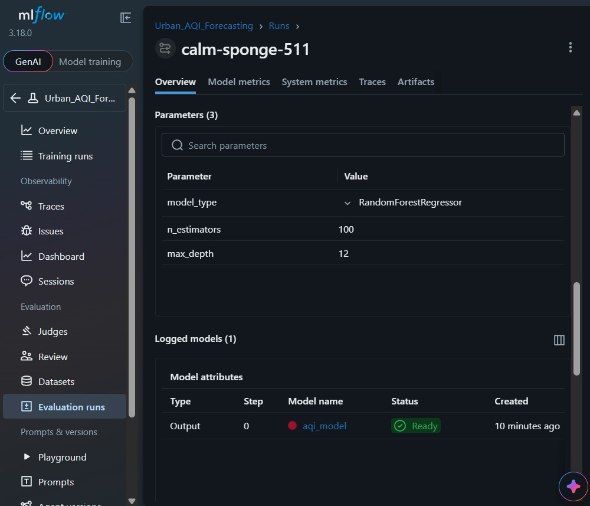
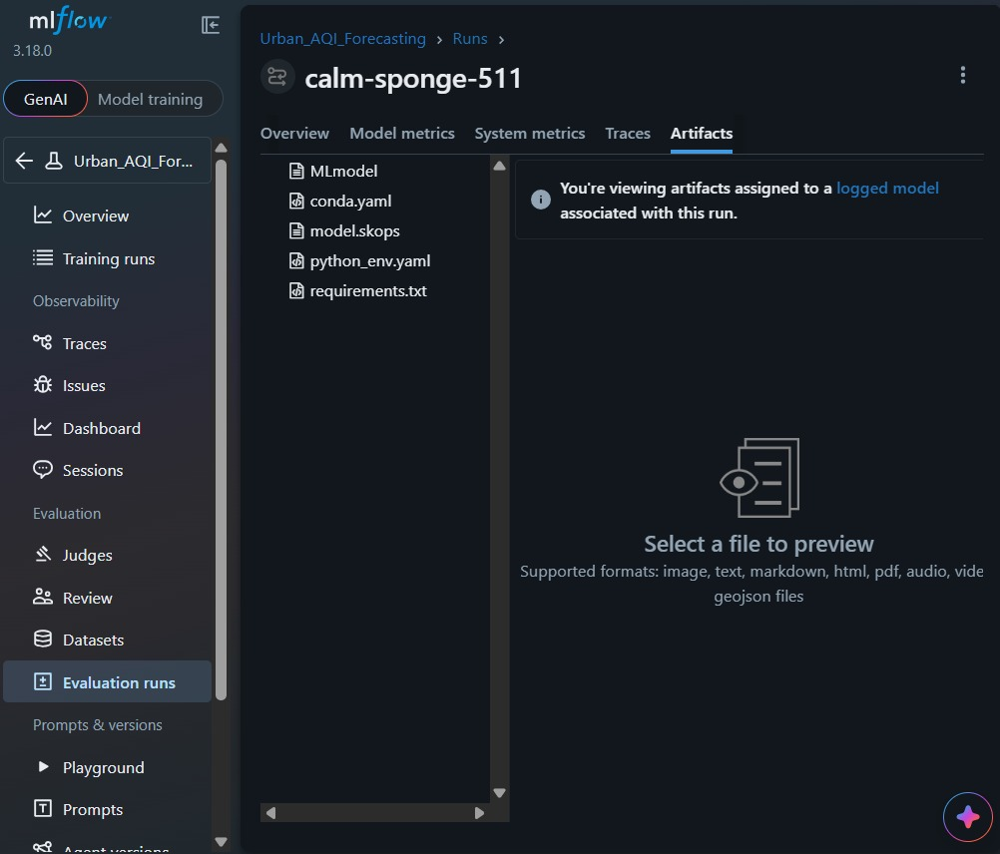

# Urban Air Quality (AQI) Forecasting MLOps Pipeline

End-to-end MLOps pipeline for Indian CPCB Urban AQI forecasting, featuring automated data ingestion, model training, artifact validation, CI/CD containerization via GitHub Actions + GHCR, and FastAPI inference.

## Architecture
- **Orchestration (`aqi_dag.py`)**: Apache Airflow DAG managing data ingestion (`ingest.py`), model training (`train.py`), and model artifact validation (`model.joblib`).
- **Inference Service (`main.py`)**: FastAPI microservice exposing `/health` and `/predict` endpoints.
- **CI/CD (`.github/workflows/ci.yml`)**: Automated `pytest` suite, Docker build, and publishing to GitHub Container Registry (`ghcr.io`).

## Quickstart (Docker)
    docker run -d -p 8080:8000 --name aqi-api ghcr.io/mohd2428cse2293-dotcom/urban-aqi-mlops-pipeline:latest

Open `http://localhost:8080/docs` for interactive Swagger UI inference.

## Pipeline Verification & Results

### 1. MLflow Experiment Tracking & Model Artifacts

### 2. MLflow Hyperparameters & Registered Model

